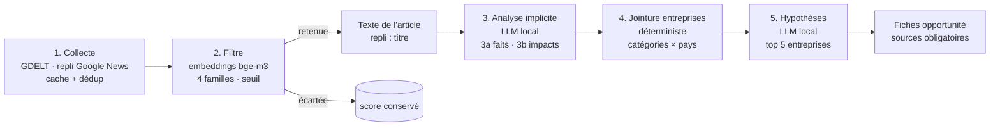

# Veille par impact — brique Data

Hackathon Givaudan AI Challenge — thématique 01 « La relation commerciale à l'ère de l'IA ».

> Statut : V2. La seule section marquée 🚧 attend le jeu de référence annoté par l'équipe.

Le repo contient deux briques indépendantes :

| Dossier | Rôle | État |
|---|---|---|
| [`rag/`](rag/) | RAG d'origine (questions sur une histoire, Ollama + ChromaDB). Réutilisé comme socle technique. | inchangé — voir [rag/README.md](rag/README.md) |
| [`veille/`](veille/) | Brique « Veille par impact » : pipeline en 5 étapes exposé par une API FastAPI. | nouveau |

---

## 1. Problème et proposition de valeur

Les commerciaux passent à côté d'actualités importantes pour leurs clients, en particulier
celles qui **ne citent pas le client** mais touchent ses produits : une restriction réglementaire
sur un ingrédient, une flambée du prix de la vanille, une tendance de goût qui monte, le rachat
d'un concurrent. Une veille par mots-clés sur le nom du client ne les voit pas.

La brique « Veille par impact » part de l'actualité, en déduit **quels produits et quels pays
sont touchés**, puis **quelles entreprises clientes** fabriquent ces produits dans ces pays.
Pour chacune, elle propose une **hypothèse d'opportunité** et **une question à poser au client**.
Chaque fiche est sourcée et sépare strictement les faits (issus de l'article) des hypothèses.

## 2. Pipeline



| Étape | Rôle | LLM génératif ? |
|---|---|---|
| 1. Collecte | Une requête GDELT par famille et par langue (≈ 1 requête / 5 s), repli Google News RSS si GDELT bloque, cache disque, déduplication par URL et titre normalisé. | non |
| 2. Filtre | Compare chaque titre aux descriptions de référence des 4 familles (réglementation sensorielle, matières premières aromatiques, tendances goût/odorat, mouvements d'entreprises F&F) et à des contre-exemples « hors périmètre ». Conserve famille + score. Le texte de l'article n'est récupéré que pour les actualités retenues. | non (embeddings) |
| 3. Analyse implicite | (a) extrait les faits sourcés ; (b) en déduit la chaîne fait → conséquence → impact sensoriel, les catégories, pays, ingrédients et un niveau de confiance. | oui |
| 4. Jointure | Rapproche catégories et pays de l'étape 3 (vocabulaire contrôlé) d'une base de 45 groupes construite depuis Open Food Facts / Open Beauty Facts et indexée dans ChromaDB. Chaque entreprise porte `raison` et `source`. | non |
| 5. Hypothèses | Pour les 5 meilleures entreprises : type d'opportunité, division Givaudan, fenêtre d'action, question client, confiance. Validation après coup : toute entreprise ou fait absent des entrées est rejeté. | oui |

## 3. Choix techniques

### Réutilisation du RAG existant

Le RAG d'origine (`rag/`) fournit FastAPI, ChromaDB persistante (distance cosinus) et un
client Ollama. La brique de veille **réutilise ce code** via [`veille/rag_bridge.py`](veille/rag_bridge.py)
(client ChromaDB, client Ollama) au lieu de le dupliquer, et stocke ses données dans
**des collections distinctes** du même dossier `rag/chroma_db/`. La collection `story` et
`rag/api.py` ne sont pas modifiés.

Écarts assumés par rapport au RAG d'origine :

| Sujet | RAG d'origine | Veille | Pourquoi |
|---|---|---|---|
| Embeddings | `nomic-embed-text` | `bge-m3` | Actualités en français (et anglais) : bge-m3 est multilingue, nomic surtout anglophone. |
| LLM | `qwen2.5:1.5b` | `qwen3:8b` (repli `qwen3:4b`) | Sorties JSON structurées et raisonnement d'impact : un 1,5B ne suffit pas. |
| Port | 8000 | 8001 | Les deux API peuvent tourner en même temps. |
| Config | `rag/config.py` | `veille/settings.py` + `.env` | Nom distinct pour éviter le conflit d'import avec `config`. |

⚠️ `rag/config.py` lit aussi `LLM_MODEL` et `EMBED_MODEL`. Le fichier `.env` n'est chargé que par
la brique de veille ; **n'exportez pas** ces variables dans votre shell si vous lancez aussi
`rag/api.py`, sinon l'histoire serait interrogée avec un autre modèle d'embeddings que celui
de son index.

### Modèles 100 % locaux (Ollama)

- **Coût** : aucun appel payant, démo reproductible.
- **Portabilité** : Ollama tourne sur macOS, Windows et Linux, avec ou sans GPU.
- **Confidentialité** : à terme, des données CRM / internes Givaudan pourront être croisées sans sortir de la machine.

### Sources d'actualités

| Source | Rôle | Pourquoi |
|---|---|---|
| **GDELT DOC 2.0** | principale | Gratuite, sans clé, mondiale, filtrable par langue (`sourcelang:`) et par période. |
| **Google News RSS** | repli automatique | Pendant le hackathon, GDELT renvoyait presque toujours « Please limit requests to one every 5 seconds », même avec 1 requête / minute (IP publique probablement partagée avec d'autres équipes). Google News RSS est gratuit, sans clé, avec une bonne couverture française. Il n'est utilisé que pour les requêtes où GDELT échoue. |
| **GNews** | optionnelle (`GNEWS_API_KEY`) | Apporte une description d'article. Connecteur prévu par l'interface, pas encore implémenté en V2. |

Alternatives écartées : **NewsAPI** (offre gratuite limitée au développement, articles avec 24 h de
retard, usage en production interdit), **flux RSS de médias choisis à la main** (couverture
arbitraire, à maintenir), **scraping de sites** (fragile, conditions d'usage), **Event Registry /
Factiva** (payants).

Toutes les sources implémentent la même interface [`NewsSource`](veille/collect/base.py) : ajouter une
source (presse spécialisée, base interne Givaudan) ne demande qu'une classe avec une méthode `search`.

### Embeddings (étape 2) : bge-m3

- **Multilingue** (français et anglais dans le même espace) : une description de famille en français
  reconnaît aussi un titre anglais.
- Local via Ollama, 1,2 Go, rapide sur CPU.
- Le filtre compare des **titres** à des descriptions **rédigées comme des titres**, ce qui donne
  de meilleurs scores que des définitions abstraites. Des **contre-exemples** (tech, sport, politique,
  énergie, faits divers) évitent qu'une actualité « business » générique (« Apple dévoile un iPhone »)
  passe le seuil.

### Choix du modèle par étape

| Étape | Modèle | Pourquoi |
|---|---|---|
| 1. Collecte | aucun | Appels d'API et règles déterministes. |
| 2. Filtre | bge-m3 (embeddings) | Classer des centaines de titres en quelques secondes, de façon reproductible et explicable (un score par famille). Un LLM génératif serait 100× plus lent pour un gain incertain. |
| 3. Analyse | qwen3:8b (ou 4b) | Seule étape qui demande de comprendre un texte et de raisonner sur ses conséquences. Découpée en 2 appels (faits, puis hypothèses) pour séparer strictement les deux. |
| 4. Jointure | aucun | Une entreprise doit être rattachée pour une raison **vérifiable** (catégorie et pays communs, avec leur source). Un LLM pourrait inventer un lien plausible mais faux. |
| 5. Hypothèses | qwen3:8b (ou 4b) | Rédiger une hypothèse et une question client demande de la génération. Le champ `entreprise` est contraint par JSON Schema à la liste fournie, et une validation après coup rejette toute entreprise ou tout fait absent des entrées. |

Réglages LLM : sortie contrainte par le JSON Schema Pydantic (paramètre `format` d'Ollama),
mode « thinking » de Qwen3 désactivé, température 0,1, une nouvelle tentative si la validation
échoue, cache des réponses. 2 exemples few-shot **fictifs** (marqués comme tels) par prompt.
Les prompts sont en français et la sortie est toujours en français, même pour un article en anglais.

### Contrôles anti-hallucination (sans LLM)

| Contrôle | Étape | Effet |
|---|---|---|
| La citation d'un fait doit se retrouver dans l'article (≥ 70 % de ses mots) | 3a | fait rejeté |
| Un maillon de la chaîne d'impact doit reprendre un fait extrait | 3b | maillon rejeté |
| Catégories et pays limités au vocabulaire contrôlé (`data/vocab.json`) | 3b | valeur imposée par le schéma |
| L'entreprise doit être dans la liste fournie | 5 | opportunité rejetée |
| `faits_utilises` doit pointer vers des faits existants | 5 | opportunité rejetée |
| Le texte ne doit citer aucune autre entreprise/marque connue de la base | 5 | opportunité rejetée |
| Si seul le titre a pu être lu (paywall, lien Google News…), la confiance est plafonnée à « moyen » | 3 et 5 | `diagnostic.texte_analyse = "titre"` |

Les rejets sont visibles dans `diagnostic.rejets_validation` de chaque réponse.

### Français prioritaire

`NEWS_LANGUAGES=french` par défaut ; l'anglais s'active avec `NEWS_LANGUAGES=french,english`
(une requête par langue, fusion puis déduplication). Les descriptions de référence existent dans
les deux langues ; seules celles des langues activées sont utilisées (score = maximum). Le seuil
peut être réglé par langue (`FILTER_THRESHOLD_FR`, `FILTER_THRESHOLD_EN`).

## 4. Sources de données, licences et conditions d'usage

| Donnée | Source | Licence / conditions | Ce qu'on en garde |
|---|---|---|---|
| Actualités | [GDELT DOC 2.0](https://blog.gdeltproject.org/gdelt-doc-2-0-api-debuts/) | Accès libre et gratuit ; citer GDELT ; ~1 requête / 5 s. | Titre, URL, média, date, langue, pays du média. |
| Actualités (repli) | Google News RSS | Usage personnel / non commercial selon les conditions de Google ; à remplacer par une source sous contrat avant tout usage commercial. | Titre, lien, média, date. |
| Texte des articles | Sites des médias | Droit d'auteur des éditeurs : le texte n'est utilisé qu'en mémoire / cache local pour l'analyse, jamais republié. Les fiches ne contiennent que de courtes citations sourcées. | Citations courtes (droit de citation). |
| Entreprises | [Open Food Facts](https://world.openfoodfacts.org) et [Open Beauty Facts](https://world.openbeautyfacts.org) | Base : **ODbL** (attribution + partage à l'identique de la base dérivée `data/companies.json`). | Catégories et pays de commercialisation par marque, avec URL de vérification. |
| Liste des groupes | `data/companies_seed.json` (saisie manuelle) | — | Nom du groupe et étiquettes de marques. |

La base d'entreprises est générée par `python -m veille.companies build` puis indexée par
`python -m veille.companies index` (collection ChromaDB `veille_entreprises`, embeddings bge-m3).
Pour chaque groupe, on échantillonne jusqu'à 100 produits par base (OFF via `search.openfoodfacts.org`,
OBF via son API v2), puis on garde les catégories et pays qui représentent au moins 3 % de l'échantillon
(et au moins 3 produits). Les étiquettes OFF/OBF sont ramenées au vocabulaire contrôlé par la table
`off` de [`data/vocab.json`](data/vocab.json). Les étiquettes trop larges (`en:beverages`,
`en:plant-based-foods`) ont été volontairement exclues : elles rangeaient la bière parmi les boissons
sans alcool et presque toute l'épicerie parmi les alternatives végétales. Elle n'est pas éditée à la main : chaque catégorie et chaque pays
d'une entreprise vient d'un comptage de produits vérifiable sur la page OFF/OBF indiquée dans `source`.
Wikidata (liens groupe → marques → pays) est prévu pour la V3.

## 5. Installation, configuration, lancement

### Configuration minimale

| Machine | `LLM_MODEL` | Remarque |
|---|---|---|
| 8 Go de RAM | `qwen3:4b` | Plus lent et moins fin, mais fonctionnel. |
| 16 Go de RAM ou plus | `qwen3:8b` (défaut) | Recommandé. GPU facultatif. |
| N'importe quelle machine | — | `DEMO_MODE=true` rejoue des sorties précalculées : ni réseau ni LLM nécessaires. |

### Installation

Prérequis : Python 3.10+ et [Ollama](https://ollama.com).

```bash
python -m venv .venv
# macOS / Linux :          source .venv/bin/activate
# Windows PowerShell :     .venv\Scripts\Activate.ps1
pip install -r requirements.txt

ollama pull qwen3:8b      # ou qwen3:4b sur une machine à 8 Go
ollama pull bge-m3

cp .env.example .env      # Windows : copy .env.example .env
python -m veille.check_env   # vérifie Ollama et les modèles
```

### Préparer les données (une fois, avec réseau)

Les fichiers `data/companies.json` et `data/demo/` sont versionnés : cette étape n'est utile que pour
les régénérer.

```bash
python -m veille.companies build     # ~15 min : interroge Open Food/Beauty Facts → data/companies.json
python -m veille.companies index     # indexe la base dans ChromaDB (obligatoire au 1er lancement live)
python -m veille.filter --reindex    # calcule les embeddings des 4 familles (sinon fait au 1er appel)
python -m veille.demo build          # fige un jeu de démo réel (collecte + 6 analyses, ~10 min)
```

Tester le filtre sur des titres : `python -m veille.filter "Le prix du cacao s'envole" "Grève SNCF mardi"`.

### Lancement

```bash
python -m veille.api                     # http://localhost:8001/docs
python -m pytest -q tests                # tests unitaires (sans réseau ni Ollama)
```

| Mode | Comment | Ce que ça fait |
|---|---|---|
| Live | défaut | GDELT + Ollama en direct. |
| Démo | `DEMO_MODE=true` dans `.env` | Rejoue les sorties figées de `data/demo/` (45 actualités réelles du 12/11/2026, 6 analysées, 25 fiches). Ni réseau ni Ollama. `/analyze` n'accepte que les URL de `data/demo_news.json` (404 sinon). |
| Dummy | `DUMMY_MODE=true`, ou `?dummy=true` sur un appel | Réponses factices conformes au contrat (marquées `[DUMMY]`). |

Au démarrage, l'API vérifie Ollama et les modèles. S'il manque quelque chose, elle démarre quand
même et `/health` affiche la commande à exécuter (`ollama pull …`).

### Exposition via ngrok

```bash
python -m veille.api          # terminal 1
ngrok http 8001               # terminal 2 → URL publique https://xxxx.ngrok-free.app
```

- Swagger : `https://xxxx.ngrok-free.app/docs`.
- Appels programmatiques : ajouter l'en-tête `ngrok-skip-browser-warning: 1` (sinon ngrok
  renvoie sa page d'avertissement HTML au lieu du JSON).
- CORS ouvert (`*`) : un front servi depuis n'importe quel domaine peut appeler l'API.

## 6. Documentation de l'API

Swagger interactif : `http://localhost:8001/docs` · contrat OpenAPI : `/openapi.json`.
Les exemples de réponse du Swagger sont générés depuis le mode dummy, donc toujours conformes.

| Méthode | Route | Rôle |
|---|---|---|
| GET | `/health` | Ollama, modèles, mode actif, réglages effectifs (sans secret). |
| POST | `/analyze` | Analyse une actualité (`actualite` ou simple `url`) à travers les étapes 2 à 5. |
| GET | `/opportunities` | Pipeline complet sur une requête et une période. |

Tous les endpoints acceptent `?dummy=true`.

```bash
# Une actualité
curl -X POST "http://localhost:8001/analyze?dummy=true" \
  -H "Content-Type: application/json" \
  -d '{"actualite": {"titre": "L UE restreint un allergène parfumant", "url": "https://example.org/a", "langue": "french"}}'

# Une simple URL
curl -X POST "http://localhost:8001/analyze?dummy=true" \
  -H "Content-Type: application/json" -d '{"url": "https://example.org/a"}'

# Pipeline complet sur 7 jours
curl "http://localhost:8001/opportunities?q=vanille&periode=7d&langues=french&dummy=true"
```

Structure d'une fiche (`FicheOpportunite`) :

| Champ | Contenu |
|---|---|
| `signal` | titre, média, date, URL de l'actualité |
| `ce_que_ca_implique` | résumé de l'impact (hypothèse) |
| `faits` | faits **sourcés** (énoncé, citation, URL) |
| `chaine_impact` | fait → conséquence → impact sensoriel (hypothèses) |
| `entreprise` | nom, `raison` du rattachement, `source` |
| `opportunite` | type, division Givaudan, fenêtre d'action, hypothèse |
| `question_a_poser` | question ouverte pour le client |
| `confiance` | `élevé` / `moyen` / `spéculatif` / `inconnu` |
| `sources` | **toujours présent** : article + référence entreprise |

Tout champ qualitatif accepte `"inconnu"` plutôt que d'inventer une valeur.

## 7. Évaluation

### Pourquoi séparer le système et la vérité terrain

Si le pipeline remplissait lui-même les réponses attendues, il s'évaluerait sur ses propres sorties :
les scores seraient mécaniquement bons et ne mesureraient rien. Le code du pipeline n'écrit donc
jamais d'annotation : `build_reference_set.py` crée les champs vides et conserve les annotations
existantes s'il est relancé.

> **Statut du jeu de référence** : jeu de référence annoté et hypothèses notées par un LLM indépendant du pipeline (Claude), sans validation par un expert métier Givaudan, indisponible pendant le hackathon. Les scores mesurent donc l'accord avec un analyste sectoriel généraliste, pas avec la vérité terrain de Givaudan.

### Procédure

1. L'équipe dépose `eval/news_to_annotate.json` : `[{id, titre, date, media, url, langue}, ...]`.
2. `python eval/build_reference_set.py` crée `eval/reference_set.json` (champs source remplis,
   champs d'annotation vides).
3. Un LLM indépendant du pipeline (Claude, et non le modèle local qwen3 qui produit les fiches)
   produit un brouillon d'annotations (`eval/annotations_draft.json`), fusionné dans
   `reference_set.json` par `id`. Le brouillon est ensuite aligné sur les noms exacts de
   `data/companies.json` et sur les identifiants de familles du pipeline ; une entreprise absente
   de la base est retirée et signalée dans `commentaire`.
4. Un membre de l'équipe relit et valide chaque entrée. Champs :

   | Champ | Valeurs |
   |---|---|
   | `pertinente` | `oui` / `non` : l'actualité peut-elle impacter les produits d'un client F&F ? |
   | `famille` | `reglementation_sensorielle`, `matieres_premieres_aromatiques`, `tendances_gout_odorat`, `mouvements_entreprises_ff` (vide si `non`) ; toute autre valeur fait échouer `run_eval.py` |
   | `entreprises_attendues` | noms tels qu'ils figurent dans `data/companies.json` |
   | `opportunite_attendue` | texte libre |
   | `annotateur`, `commentaire` | auteur de l'annotation, remarques |

   Conseil : faire relire une partie des entrées par un deuxième membre pour mesurer l'accord.
5. Lancer l'API, puis `python eval/run_eval.py` (`--api https://xxxx.ngrok-free.app` pour une API
   distante, `--verifier-urls` pour tester chaque URL source). Les entrées sans `pertinente` sont ignorées.
6. Noter les hypothèses exportées dans `eval/hypotheses_to_rate.csv` (colonne `note_humaine` :
   `plausible` / `non plausible`). Ce CSV s'ouvre dans Excel (séparateur `;`).

### Critères

| Critère | Calcul |
|---|---|
| Précision du filtre | actualités retenues ET annotées pertinentes / actualités retenues (rappel donné pour information) |
| Famille exacte | parmi les vrais positifs annotés avec une famille |
| Entreprises justifiées | entreprises avec `raison` non vide et `source` URL http(s) (qui répond, avec `--verifier-urls`) / entreprises retournées |
| JSON valides | appels LLM validés par Pydantic / appels LLM (y compris nouvelles tentatives) |
| Hypothèses plausibles | notation humaine du CSV |

### Mesures automatiques sur le jeu de démo (sans vérité terrain)

Mesures produites par le système lui-même sur `data/demo/` (12/11/2026, `qwen3:8b`, `bge-m3`,
seuil 0,50). Elles ne disent rien de la pertinence : seulement de la robustesse technique.

| Mesure | Valeur |
|---|---|
| Actualités collectées / retenues par le filtre | 45 / 18 |
| Actualités analysées (sélection alternée par famille) | 6 (3 familles) |
| Sorties JSON valides du premier coup | 18 / 18 (100 %) |
| Fiches produites | 25 |
| Entreprises avec `raison` + `source` URL | 25 / 25 (100 %) |
| Rejets par les contrôles après coup | 0 (1 rejet sur une génération précédente : hypothèse citant une entreprise hors entrées) |
| Durée moyenne d'analyse d'une actualité (MacBook, CPU/GPU Apple) | ≈ 40 à 75 s |

Toutes ces actualités venaient du repli Google News (GDELT bloqué) : le texte des articles n'a pas pu
être lu et la confiance est plafonnée à « moyen ».

### Résultats sur le jeu de référence (V2)

Mesurés le 12/11/2026 sur les 20 actualités de `eval/reference_set.json` (13 pertinentes, 7 non
pertinentes), API locale en mode live (`qwen3:8b`, `bge-m3`, seuil 0,50). Détail :
`eval/results_v2_avant.json` et `eval/hypotheses_to_rate_v2_avant.csv` (58 hypothèses).

| Critère | Résultat V2 |
|---|---|
| Précision du filtre | **92,3 %** (VP 12, FP 1) |
| Rappel du filtre (information) | 92,3 % (FN 1, VN 6) |
| Famille exacte (sur les vrais positifs) | **91,7 %** (11/12) |
| Entreprises justifiées (raison + source URL) | **100 %** (60/60) |
| Sorties JSON valides | **100 %** (38/38, 0 rejet) |
| Entreprises attendues retrouvées | **36,7 %** |
| Hypothèses plausibles (notation par un LLM indépendant, sans expert métier) | **43 %** (25/58) |
| Erreurs API | 0 |

**Les 3 erreurs du filtre**

| Actualité | Erreur | Score | Explication |
|---|---|---|---|
| n05 — « La FDA propose de rendre obligatoires les notifications GRAS » | faux négatif | 0,474 | Réglementation américaine, peu représentée dans les descriptions de référence (françaises et européennes). |
| n11 — « Yuka et des chercheurs publient un livre blanc sur le lobbying contre le Nutri-Score » | faux positif | 0,508 | Titre très proche du thème réglementaire sans annoncer de mesure. |
| n08 — « Taxe sur les produits sucrés : le gouvernement ouvre la porte, les industriels s'inquiètent » | mauvaise famille (mouvements au lieu de réglementation) | 0,526 | « les industriels » rapproche le titre des descriptions de mouvements d'entreprises. |

**Pourquoi le seuil reste à 0,50.** Les deux erreurs de classement retenu/écarté sont de part et
d'autre du seuil, à moins de 0,03. Le monter au-dessus de 0,508 pour écarter n11 ferait perdre n03
(vanille, 0,506, pertinente) ; le baisser à 0,47 pour récupérer n05 le placerait à 0,01 de n02
(résultats dsm-firmenich, 0,462, non pertinente). Avec 20 actualités, déplacer le
seuil reviendrait à l'ajuster sur une ou deux entrées, c'est-à-dire à surapprendre. Les erreurs
relèvent plutôt des descriptions de référence (ajouter la réglementation hors UE, préciser
« mouvements ») que du seuil.

**Pourquoi seulement 36,7 % des entreprises attendues sont retrouvées**

1. **Classement favorable aux groupes diversifiés.** Le score ajoute 1 point par catégorie commune :
   un groupe peu présent dans beaucoup de catégories (Carrefour marques propres) passe devant un
   spécialiste (Mondelēz, Ferrero). Avec 5 entreprises maximum par actualité, Ferrero n'est retrouvé
   sur aucune des 7 actualités où il était attendu. L'étape 3 coche aussi trop de catégories (jusqu'à 5,
   dont parfumerie et soins pour la vanille), ce qui dilue la jointure.
2. **Pays d'origine pris pour un marché (matières premières).** Pour la récolte de cacao ivoirienne
   (n10), l'analyse retient « CI » ; aucune entreprise de la base n'y est commercialisée : 0 entreprise,
   0 fiche.
3. **L'étape 5 peut ignorer une entreprise rattachée.** Pour « L'Oréal finalise l'acquisition de
   Kering Beauté » (n12), la jointure place L'Oréal en tête, mais le LLM ne produit aucune hypothèse
   pour elle.

**Défauts de l'étape 5 relevés par la notation des hypothèses (33 non plausibles sur 58)**

Notes dans `eval/hypotheses_to_rate_v2_avant.csv` (LLM indépendant du pipeline, sans expert métier).

1. **Contresens sur la direction des prix** (n03 vanille, n15 cacao) : l'hypothèse raisonne sur une
   hausse quand les faits décrivent une baisse, ou l'inverse.
2. **Hypothèses hors métier** (n06 Nutri-Score) : propositions sur l'emballage ou l'étiquetage, qui ne
   relèvent pas d'un fabricant d'arômes et de parfums.
3. **Prémisses absentes de l'article** (n11) : l'hypothèse s'appuie sur une mesure ou une intention
   que les faits extraits ne mentionnent pas.
4. **Entreprises mal choisies** (n12) : hypothèses pour des concurrents plutôt que pour l'entreprise
   citée (L'Oréal) ; corrigé en partie par la correction b ci-dessous.
5. **Fenêtres d'action incohérentes avec les dates** (n17) : délai proposé sans rapport avec
   l'échéance donnée dans les faits (31 juillet 2026).

Les contrôles après coup ne détectent pas ces défauts : les faits cités sont valides, c'est le
raisonnement qui est faux. Des règles de prompt ciblées (goût, odeur ou formulation uniquement ;
sens de variation repris des faits ; aucune prémisse absente ; fenêtre calculée à partir des dates des
faits) sont prévues mais **n'ont pas été appliquées faute de temps** avant l'échéance du hackathon.

### Corrections : tableau avant / après

> Score après correction mesuré sur le même jeu de 20 actualités, donc optimiste ; un jeu de test
> séparé reste à constituer.

Corrections retenues (tests verts après chacune) :

- **a. Matières premières** : pour cette famille, les pays cités sont des pays d'origine, pas des
  marchés ; le critère pays est neutre dans la jointure. La récolte de cacao ivoirienne (n10) passe
  de 0 à 5 fiches et de 0/5 à 2/5 entreprises attendues.
- **b. Entreprise citée dans le titre** : si l'étape 5 ne produit pas d'hypothèse pour elle, un
  second appel ciblé l'impose (JSON Schema `minItems`), avec les mêmes contrôles anti-invention.
  L'Oréal a désormais sa fiche pour l'acquisition de Kering Beauté (n12).

| Critère | V2 (avant) | Essai a + b + c (écarté) |
|---|---|---|
| Précision du filtre | 92,3 % | 92,3 % |
| Rappel du filtre | 92,3 % | 92,3 % |
| Famille exacte | 91,7 % | 91,7 % |
| Entreprises justifiées | 100 % (60/60) | 100 % (65/65) |
| Sorties JSON valides | 100 % (38/38) | 100 % (40/40) |
| Entreprises attendues retrouvées | 36,7 % | 32,7 % |
| Hypothèses produites | 58 | 63 |
| Hypothèses plausibles | 43 % (25/58) | non noté |

Le filtre n'a pas été modifié : ses scores sont identiques. Détail : `eval/results_v2_apres.json`.
La version livrée (a + b, sans c) n'a pas été remesurée faute de temps : ses effets ci-dessus ont été
vérifiés actualité par actualité pendant l'essai.

**Essai écarté : c. Classement par part de produits et étape 3 limitée à 3 catégories.**
Le score devenait la part des produits de l'entreprise dans les catégories visées (au lieu d'un point
par catégorie commune). Il a fait remonter les spécialistes (taxe sur les confiseries, n01 : 2/4 → 3/4,
Mondelēz et Ferrero retrouvés) mais a fait baisser le rappel global (36,7 % → 32,7 %). Il est écarté
pour deux raisons structurelles, pas pour son score :

- **il pénalise par construction les groupes diversifiés** : Nestlé, attendu sur 11 actualités, n'est
  plus retrouvé sur aucune. Ses produits sont répartis sur 7 catégories (17 à 26 % chacune) : il ne
  domine aucune catégorie alors qu'il est concerné par presque toutes ;
- **la limite à 3 catégories rend le rappel dépendant du choix du LLM** : pour la taxe sucre (n14),
  il retient nutrition infantile, plats préparés et boissons, mais pas la confiserie (0/4).

Aucun score intermédiaire (part + poids du groupe, quota spécialistes / généralistes) n'a été testé
sur le jeu d'évaluation, pour éviter de sur-ajuster le système à ces 20 actualités : cela demande un
jeu de test séparé.

## 8. Limites et risques

- **Modèle local moins fin qu'un grand modèle** : qwen3:8b (et a fortiori 4b) peut manquer une
  conséquence indirecte ou rester générique. Les contrôles après coup limitent les inventions, pas
  les hypothèses banales. Chaque hypothèse porte une `confiance` et doit être relue par un humain.
- **Hallucinations** : réduites (sortie contrainte, faits cités, entreprises imposées, rejets
  automatiques) mais pas nulles. Une citation peut être fidèle et l'hypothèse quand même fausse.
- **Filtre surtout sur les titres** : un titre accrocheur ou vague peut être mal classé ; le texte
  n'est lu que pour les actualités déjà retenues. Le repli Google News ne permet pas de lire le texte
  (lien de redirection) : l'analyse se fait alors sur le titre seul, et l'URL du signal est un lien
  `news.google.com` qui redirige vers l'article.
- **Couverture française plus faible et plus tardive** : GDELT couvre mieux l'anglais et indexe avec
  un délai (de quelques minutes à quelques heures). L'anglais s'active via `NEWS_LANGUAGES`.
- **Disponibilité des API gratuites** : GDELT limite fortement le débit (bloquant pendant le hackathon),
  Google News RSS n'a pas de garantie de service. `DEMO_MODE` protège la démo.
- **Seuils à calibrer** : `FILTER_THRESHOLD` (0,50) et les contre-exemples ont été réglés sur peu
  d'exemples. Le jeu de référence (20 actualités) le confirme mais est trop petit pour l'optimiser.
- **Base d'entreprises réduite et biaisée** : 45 groupes choisis à la main ; certains n'ont aucune
  catégorie exploitable (Reckitt, Shiseido : produits mal étiquetés sur OBF) et des marques historiques
  faussent parfois le profil (Procter & Gamble apparaît en snacks via d'anciens produits Pringles) ; Open Food/Beauty Facts est
  contributif, surtout européen (France très représentée) ; catégories et pays sont estimés sur un
  échantillon de 100 produits par base ; une marque mal étiquetée fausse le profil.
- **Vérité terrain non experte** : jeu de référence annoté et hypothèses notées par un LLM indépendant du pipeline (Claude), sans validation par un expert métier Givaudan, indisponible pendant le hackathon. Les scores mesurent donc l'accord avec un analyste sectoriel généraliste, pas avec la vérité terrain de Givaudan.
- **Données synthétiques** : seuls le mode dummy (marqué `[DUMMY]`, domaine `example.org`) et les
  exemples few-shot (marqués « fictif ») sont inventés. Les actualités de la démo sont réelles et figées.
- **RGPD** : aucune donnée personnelle n'est collectée volontairement. Les articles peuvent citer des
  personnes physiques : le texte n'est conservé qu'en cache local (`data/cache/`, non versionné).
  Croiser avec un CRM demandera une analyse d'impact (base légale, durée de conservation).
- **Biais** : les médias indexés, la langue et le choix des descriptions de référence orientent ce qui
  est vu. Une actualité absente des sources ne sera jamais détectée.

## 9. Pistes d'évolution

- **Sources internes Givaudan** : fiches clients, portefeuille produits, notes de visite, veille
  réglementaire interne → nouveaux connecteurs `NewsSource` et une base d'entreprises enrichie.
- **CRM** (Salesforce…) : remplacer la base Open Food/Beauty Facts par le portefeuille réel de chaque
  commercial ; pousser les fiches dans le CRM avec un retour « utile / pas utile » qui alimente
  l'évaluation.
- **Temps réel** : collecte planifiée (toutes les 15 min), alertes (e-mail, Teams) au-dessus d'un seuil
  de confiance, déduplication entre jours.
- **V3 données** : Wikidata (groupe → marques → pays), presse spécialisée (Food Navigator,
  Cosmetics Design, Process Alimentaire), sources réglementaires officielles (EUR-Lex, EFSA, FDA).
- **Qualité** : calibrage des seuils sur le jeu de référence, reranking des entreprises, modèle plus
  gros quand le matériel le permet (variable `LLM_MODEL`).
